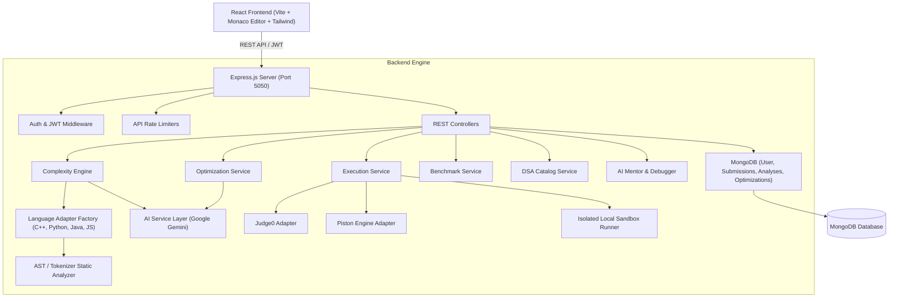

# CodeSense AI – AI-Powered Multi-Language Code Analysis & Optimization Platform

> **CodeSense AI** is an intelligent coding mentor, algorithmic performance analyzer, and automated optimization platform designed for modern software engineers. It combines language-specific AST and static structural inspection with LLM reasoning to estimate time and space complexities, detect algorithmic patterns, generate optimized implementations, execute code securely, and validate performance empirically across C++, Python, Java, and JavaScript.

---

## Table of Contents

1. [Project Overview](#project-overview)
2. [Key Features](#key-features)
3. [Technology Stack](#technology-stack)
4. [System Architecture](#system-architecture)
5. [Folder Structure](#folder-structure)
6. [Prerequisites](#prerequisites)
7. [Installation & Setup](#installation--setup)
8. [Environment Configuration](#environment-configuration)
9. [Running the Application](#running-the-application)
10. [REST API Documentation](#rest-api-documentation)
11. [Code Execution Engine & Security](#code-execution-engine--security)
12. [Testing & Verification](#testing--verification)
13. [Known Limitations & Future Roadmap](#known-limitations--future-roadmap)

---

## 1. Project Overview

Modern developers often rely on basic online compilers or disconnected AI chatbots that lack deep algorithmic context or fabricate complexity guarantees. CodeSense AI bridges this gap with a **hybrid architectural engine**:

- **Hybrid Complexity Estimation**: Integrates AST parsing and tokenizer heuristics (nested loop depths, logarithmic increments, recursive call branching, memory allocations) with LLM algorithmic reasoning.
- **Dual Complexity Optimization**: When optimizing code, CodeSense AI generates an optimized solution in the same language and produces two distinct complexity analyses (Original vs. AI-Optimized) with explicit trade-off explanations.
- **Secure Code Execution**: Employs an isolated code runner with strict CPU time limits, memory caps, and stdout/stderr restriction.
- **Test Case Validation**: Executes sample and custom test cases against both original and optimized solutions with line-by-line output diffs.
- **Empirical Benchmarking**: Measures wall-clock runtime across increasing input scales (Small, Medium, Large) over multiple iterations, accompanied by clear disclaimers distinguishing measured latency from theoretical Big-O complexity.
- **DSA Problem Recommendation**: Maps detected patterns (Two Pointers, Sliding Window, Dynamic Programming, Binary Search, Graphs, etc.) to curated LeetCode problems.
- **Context-Aware AI Coding & Debugging Assistant**: Chat assistant and automated error diagnostics leveraging compiler output and runtime stack traces.

---

## 2. Key Features

- **Multi-Language Monaco Editor**:
  - Full syntax highlighting, line numbers, and theme support for **Python, JavaScript, C++, and Java**.
  - Quick-action controls: Reset boilerplate, auto-format, copy code, and toggle custom stdin input.
  - Modular language adapter architecture enabling new languages without modifying core services.

- **Hybrid Complexity Engine**:
  - **Time Complexity**: Best, average, and worst-case estimates, loop nesting depth indicators, recursion branching detectors, and input sensitivity notes.
  - **Space Complexity**: Auxiliary memory vs. total footprint, tracking allocated maps, sets, dynamic arrays, and recursion call stack depth.
  - **Pattern Recognition**: Automatically identifies Two Pointers, Sliding Window, Binary Search, Hashing, Dynamic Programming, BFS/DFS, Trees, Heaps, and Sorting.
  - **Code Quality Assessment**: Highlights algorithmic bottlenecks, redundant operations, and edge-case vulnerabilities with a quality score (0–100).
  - **Explicit Confidence & Assumptions**: Communicates mathematical assumptions and limits of static/LLM heuristics.

- **Dual-View Code Optimization**:
  - Generates optimized solutions in the user's selected language.
  - Displays original vs. AI-optimized complexity badges side by side.
  - Details space-for-time trade-offs (e.g., trading $O(n)$ auxiliary memory to reduce runtime from $O(n^2)$ to $O(n)$).
  - Dedicated side-by-side Monaco diff comparison with synchronized scrolling.

- **Isolated Code Execution & Test Cases**:
  - Sandboxed execution with configurable timeout (`7000ms`) and output limits (`10000` chars).
  - Test case runner with visual pass/fail badges, expected vs. actual output diffs, and execution times.
  - Dual test validation verifying both original and optimized code against the same test suite.

- **Empirical Performance Benchmarking**:
  - Comparative bar charts (Recharts) evaluating original vs. optimized code across multiple input sizes.
  - Speedup ratio calculation (e.g., `2.4x`).
  - Strict disclaimers distinguishing host latency from asymptotic Big-O bounds.

- **Curated DSA Catalog**:
  - Filterable by pattern and difficulty (Easy, Medium, Hard).
  - Direct links to LeetCode practice problems.

- **Real Database Analytics Dashboard**:
  - Total code analyses, optimizations, submissions, and executions from actual MongoDB records.
  - Recharts Donut Chart: Programming language distribution.
  - Recharts Bar Chart: Algorithmic pattern frequency.
  - Recharts Area Chart: 7-day coding activity timeline.

- **User Authentication & History**:
  - User registration, login, JWT authorization, and bcrypt password hashing.
  - Persistent analysis history with search, language filters, preview modals, and one-click reload in the workspace editor.

---

## 3. Technology Stack

### Frontend
- **React.js 18** with **Vite**
- **Tailwind CSS** (VS Code / Cursor inspired dark aesthetic)
- **Monaco Editor** (`@monaco-editor/react`) & Monaco Diff Editor
- **React Router DOM 6**
- **Recharts** (Performance & Dashboard visual analytics)
- **Lucide React** (Modern developer iconography)
- **Axios** (Configured with request/response JWT interceptors)

### Backend
- **Node.js** (v20+ / v22+) & **Express.js**
- **MongoDB** with **Mongoose** (with resilient in-memory MongoDB fallback)
- **JWT (jsonwebtoken)** for secure token authorization
- **bcryptjs** for salted password hashing
- **express-rate-limit** for API rate limiting
- **acorn** for JavaScript AST parsing

### AI & Code Execution Services
- **Google Generative AI SDK (`@google/generative-ai`)**: Gemini API integration with structured JSON responses.
- **Judge0 CE API Adapter**: Configurable for RapidAPI or self-hosted Judge0 instances.
- **Piston API Adapter**: Configurable for Piston isolated execution engines.
- **Isolated Local Sandbox Runner**: Isolated subprocess execution (`child_process.spawn`) with strict timeouts, memory isolation, and output capping for Python and Node.js.

---

## 4. System Architecture



---

## 5. Folder Structure

```
code_sense_ai/
├── client/                               # Frontend React Application
│   ├── src/
│   │   ├── components/
│   │   │   ├── analysis/                 # ComplexityCard, BottleneckList
│   │   │   ├── chat/                     # AssistantDrawer, Quick Prompts
│   │   │   ├── common/                   # Navbar, Badge, Button, Alert, Modal
│   │   │   ├── editor/                   # MonacoCodeEditor, EditorControls, CustomInput
│   │   │   ├── execution/                # ExecutionOutput, TestCaseRunner
│   │   │   └── optimization/             # SideBySideDiff, ComplexityComparison
│   │   ├── context/                      # AuthContext, CodeEditorContext
│   │   ├── layouts/                      # MainLayout with persistent Navbar & Assistant
│   │   ├── pages/                        # Workspace, Dashboard, Comparison, Benchmarks, etc.
│   │   ├── services/                     # Axios API clients for each backend service
│   │   ├── utils/                        # languageTemplates, formatters
│   │   ├── App.jsx                       # React Router configuration
│   │   ├── main.jsx                      # App root mount
│   │   └── index.css                     # Tailwind custom dark styling
│   ├── package.json
│   ├── vite.config.js
│   └── tailwind.config.js
├── server/                               # Backend Node.js Application
│   ├── src/
│   │   ├── adapters/
│   │   │   └── languages/                # Modular adapters (Base, Python, JS, C++, Java)
│   │   ├── config/                       # db.js, env.js, dsaProblems.js
│   │   ├── controllers/                  # auth, analysis, execution, optimization, etc.
│   │   ├── middleware/                   # auth, rateLimiter, validation, errorHandler
│   │   ├── models/                       # User, Submission, Analysis, Optimization, etc.
│   │   ├── routes/                       # Express route definitions
│   │   ├── services/
│   │   │   ├── ai/                       # geminiProvider, promptTemplates, aiService
│   │   │   ├── analysis/                 # complexityEngine
│   │   │   ├── benchmarking/             # benchmarkService
│   │   │   ├── execution/                # executionService, judge0, piston, isolatedLocalRunner
│   │   │   ├── optimization/             # optimizationService
│   │   │   └── recommendations/          # recommendationService
│   │   ├── app.js                        # Express app configuration
│   │   └── server.js                     # Server entrypoint and DB initialization
│   ├── package.json
│   └── .env.example
├── .env.example                          # Root environment template
├── package.json                          # Workspace convenience scripts
└── README.md
```

---

## 6. Prerequisites

- **Node.js**: v18.0.0 or higher (v20+ recommended)
- **npm**: v9.0.0 or higher
- **MongoDB**: MongoDB 6+ or MongoDB Atlas (A resilient automatic in-memory MongoDB fallback is built-in if local MongoDB is not running).
- **Python 3**: Optional, for native isolated Python script execution.

---

## 7. Installation & Setup

1. **Clone or Navigate to the Workspace**:
   ```bash
   cd d:/code_sense_ai
   ```

2. **Install Server Dependencies**:
   ```bash
   cd server
   npm install
   ```

3. **Install Client Dependencies**:
   ```bash
   cd ../client
   npm install
   ```

---

## 8. Environment Configuration

Copy `server/.env.example` to `server/.env`:

```bash
cd server
cp .env.example .env
```

### Environment Variables Reference

| Variable | Description | Default Value |
|---|---|---|
| `PORT` | Backend server HTTP port | `5050` |
| `NODE_ENV` | Environment mode (`development` / `production`) | `development` |
| `MONGODB_URI` | MongoDB connection URI | `mongodb://127.0.0.1:27017/codesense_ai` |
| `JWT_SECRET` | Secret key for signing JWT tokens | Secure random string (32+ chars) |
| `JWT_EXPIRES_IN` | Expiration window for JWT tokens | `7d` |
| `LLM_PROVIDER` | AI provider identifier | `gemini` |
| `LLM_API_KEY` | Google Gemini API Key | *(Optional, get from Google AI Studio)* |
| `LLM_MODEL` | Gemini model name | `gemini-2.5-flash` |
| `JUDGE0_API_URL` | Judge0 service endpoint | `https://judge0-ce.p.rapidapi.com` |
| `JUDGE0_API_KEY` | RapidAPI key for Judge0 | *(Optional)* |
| `JUDGE0_HOST` | RapidAPI host for Judge0 | `judge0-ce.p.rapidapi.com` |
| `PISTON_API_URL` | Piston code execution API | `https://emkc.org/api/v2/piston` |
| `EXECUTION_TIMEOUT_MS` | Max execution duration in milliseconds | `7000` |
| `MAX_MEMORY_KB` | Max memory allocation in KB | `128000` |
| `MAX_OUTPUT_CHARS` | Output truncation character limit | `10000` |

> **Graceful Degradation Note**:
> If `LLM_API_KEY` is not provided, the platform operates using its **rule-based AST/heuristic engine**. Results will display a transparent badge indicating the heuristic source.
> For code execution, Python and JavaScript run directly using the built-in isolated sandbox runner.

---

## 9. Running the Application

### Option A: Run Backend and Frontend Concurrently

1. **Start the Backend Server**:
   ```bash
   cd server
   npm start
   ```
   *The backend will listen on `http://127.0.0.1:5050` and connect to MongoDB.*

2. **Start the Frontend Development Server** (in a separate terminal):
   ```bash
   cd client
   npx vite --host 127.0.0.1 --port 5173
   ```
   *Open your browser at `http://127.0.0.1:5173`.*

---

## 10. REST API Documentation

### Authentication (`/api/auth`)
- `POST /api/auth/register`: Register user `{ name, email, password }`
- `POST /api/auth/login`: Authenticate user `{ email, password }` -> returns `{ token, user }`
- `GET /api/auth/profile`: Get authenticated user profile *(Requires Bearer Token)*
- `PUT /api/auth/preferences`: Update editor preferences *(Requires Bearer Token)*

### Code Analysis (`/api/analysis`)
- `POST /api/analysis`: Analyze submitted code `{ language, code, title? }` -> returns hybrid complexity, patterns, quality metrics, and DSA recommendations.
- `GET /api/analysis/:id`: Retrieve single saved analysis.

### Code Optimization (`/api/optimization`)
- `POST /api/optimization`: Optimize code `{ language, code, testCases? }` -> returns optimized code, dual complexity analyses (Original vs. Optimized), trade-offs, and validation results.
- `GET /api/optimization/:id`: Retrieve saved optimization record.

### Code Execution & Test Cases (`/api/execution`)
- `GET /api/execution/languages`: Returns supported language metadata and starter templates.
- `POST /api/execution/run`: Execute code `{ language, code, customInput? }` -> returns `{ stdout, stderr, compileOutput, status, executionTimeMs, memoryKb }`.
- `POST /api/execution/test-cases`: Run test cases `{ language, code, testCases: [{ input, expectedOutput }] }` -> returns pass/fail report and output diffs.

### Performance Benchmarking (`/api/benchmarks`)
- `POST /api/benchmarks`: Benchmark original vs. optimized code `{ language, originalCode, optimizedCode, iterations? }` across small, medium, and large inputs.

### AI Assistant & Debugger (`/api/assistant`)
- `POST /api/assistant/chat`: Conversational AI mentoring with active code context.
- `POST /api/assistant/debug`: Diagnose compiler/runtime errors with targeted fixes.
- `GET /api/assistant/conversations`: List past conversation threads.

### Dashboard & Analytics (`/api/dashboard`)
- `GET /api/dashboard/stats`: Aggregates real MongoDB stats: total counts, language distribution, pattern frequencies, and 7-day activity timeline.

### Analysis History (`/api/history`)
- `GET /api/history`: Paginated history records with search and language filters.
- `GET /api/history/:id`: Detailed view of a past submission.
- `DELETE /api/history/:id`: Delete a saved record.

### DSA Problem Recommendations (`/api/recommendations`)
- `GET /api/recommendations/problems`: Curated algorithmic problems filtered by `pattern` and `difficulty`.

---

## 11. Code Execution Engine & Security

CodeSense AI adheres to strict execution isolation principles:
1. **Never Uses `eval()`**: User-submitted code is never executed inside the main Express application process.
2. **Process Isolation**: Execution runs in separate child processes inside a dedicated execution directory (`.sandbox_exec/`) with cleared environment variables.
3. **Execution Limits**: Enforces hard execution timeouts (`7000ms`), memory ceilings, and stdout/stderr character truncations (`10000` chars).
4. **Credential Isolation**: Execution API keys (Judge0/RapidAPI) reside strictly on the server and are never sent to the client.

---

## 12. Testing & Verification

Comprehensive end-to-end testing was conducted across all four supported languages:

1. **Python**: Verified with naive $O(n^2)$ Two Sum and optimized $O(n)$ hash map solution.
2. **JavaScript**: Verified using AST loop depth parsing and Map allocation detection.
3. **C++**: Tested using scope-aware brace-tracking parser, detecting vector allocations and non-recursive loop structures.
4. **Java**: Tested with HashMap instantiation and loop nesting inspection.
5. **Execution & Test Cases**: Validated sample test cases with expected vs. actual output equality and pass/fail diffing.
6. **Production Build**: Verified Vite production bundle compiles cleanly (`dist/assets/index.js` and `dist/assets/index.css`).

---

## 13. Known Limitations & Future Roadmap

- **External Execution Whitelisting**: Public Piston endpoints now require whitelisting; for C++ and Java remote execution, users should supply a `JUDGE0_API_KEY` or self-host Piston/Judge0. Python and JavaScript run natively in isolated sandboxes.
- **Micro-Benchmark Overhead**: Measured millisecond timings on local machines include process spawn and language startup latency.
- **Future Enhancements**:
  - Integration with Docker container sidecars for multi-tenant microservices.
  - Adding Rust and Go language adapters.
  - WebSocket-based real-time streaming for AI code generation.
